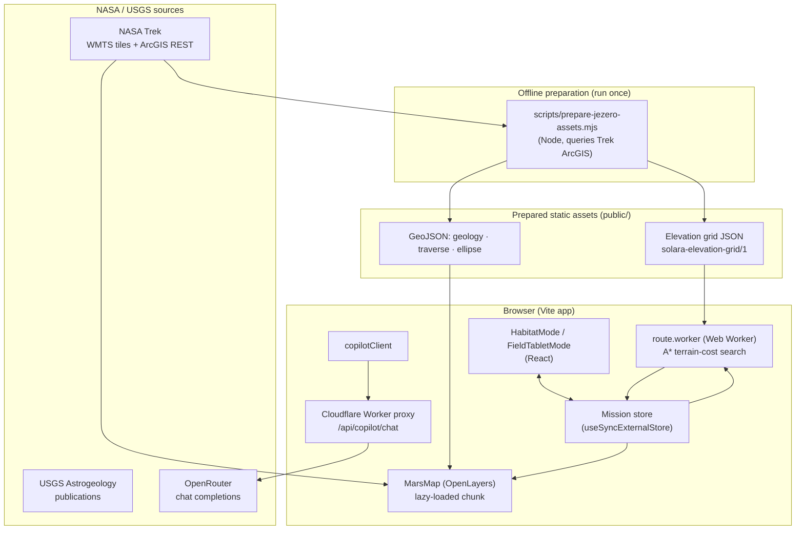
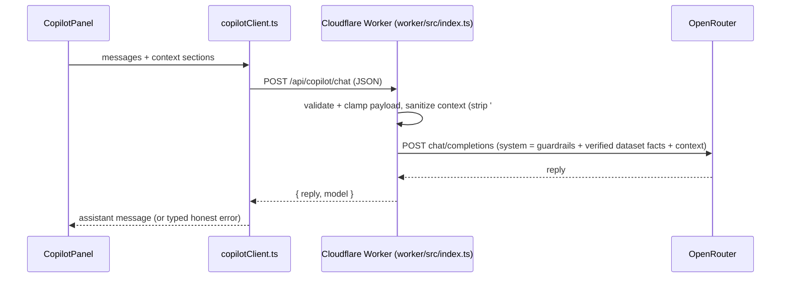

# SOLARA — Documentation

**SOLARA** is a Martian surface-intelligence and mission-planning application built for the **NASA International Space Apps Challenge 2026** (challenge: *Interplanetary Survival Guide: Martian Map*). It integrates verified NASA/USGS planetary datasets — CTX optical imagery, MOLA+HRSC topography, USGS geology, and historical Mars 2020 Perseverance rover data — into one map-centred workspace for Jezero Crater, with a prototype terrain-cost route planner and a ground-ruled **Solara AI** copilot.

**Status:** working, demonstrable MVP. Everything documented here describes the **as-built** code in this repository. Where the design-intent documents (`Context.md`, `Architecture.md`, `Design.md`) differ from the code, this document and the code are authoritative; `Architecture.md §16` and `AGENTS.md` are the as-built implementation records.

> **Scientific honesty (Context.md §7):** every displayed value is labelled *observed / derived / modelled / historical / unavailable*. Routes are **proposed terrain-cost candidates**, never "safe" or "validated". Unknown values are always visible as unknown. Nothing in this documentation invents coverage, coordinates, or scientific values that the source datasets and docs do not support.

---

## Table of Contents

1. [Product overview](#1-product-overview)
2. [Tech stack](#2-tech-stack)
3. [Architecture](#3-architecture)
4. [Data sources & dataset catalog](#4-data-sources--dataset-catalog)
5. [Mapping system (OpenLayers & CRS)](#5-mapping-system-openlayers--crs)
6. [Mission planning & route engine](#6-mission-planning--route-engine)
7. [Solara AI (AI integration)](#7-solara-ai-ai-integration)
8. [UI & design system](#8-ui--design-system)
9. [Data pipeline & prepared assets](#9-data-pipeline--prepared-assets)
10. [Environment variables](#10-environment-variables)
11. [API & endpoints reference](#11-api--endpoints-reference)
12. [Development](#12-development)
13. [Build & deployment](#13-build--deployment)
14. [Performance](#14-performance)
15. [Security](#15-security)
16. [Testing & validation](#16-testing--validation)
17. [Troubleshooting & known issues](#17-troubleshooting--known-issues)
18. [Implementation status & roadmap](#18-implementation-status--roadmap)
- [Related documents](#related-documents)
- [Repository structure](#repository-structure)

---

## 1. Product overview

SOLARA turns distributed Martian science data into understandable, location-specific exploration intelligence. It is a **planning and situational-awareness prototype** — not a certified astronaut navigation system, an operational NASA tool, or a guarantee of a safe route.

### Operating modes

Two interfaces over the **same** mission model, data catalog, and map engine (`Context.md §4.3`). The mode switch is deliberate — viewport width alone never decides the operating mode (`Design.md §13`).

| Mode | Purpose | Layout |
|---|---|---|
| **Habitat Mode** (`src/features/habitat-mode/`) | Desktop mission planning before a Marswalk: layers, dataset inspection, start/target selection, route generation, plan export | Top bar / left Mission Operations panel / centre map / right tabbed Inspector + Solara AI workspace / status bar |
| **Field Tablet Mode** (`src/features/field-tablet/`) | Touch-first execution during the excursion: route on the map, simulated position, nearest-route-point card, plan import | Map-dominant with a collapsible bottom sheet (`data-testid="tablet-sheet"`) |

### Core capabilities (all implemented)

- Mars map with zoom, pan, coordinates, click-to-inspect, and a clearly bounded **exploration region** (Jezero Crater, western fan area).
- Layered scientific visualization with source attribution and per-dataset runtime status.
- Terrain elevation: live Trek ImageServer point queries **plus** a prepared, centre-validated grid.
- **Prototype terrain-cost routing**: A* over the prepared DEM grid in a Web Worker, with distance, elevation profile, slope stats, and warnings.
- Mission plan export/import (`solara-plan/1` JSON files) shared between modes.
- Solara AI chat backed by a Cloudflare Worker proxy with server-side honesty guardrails.

### Geographic scope

Global Mars context uses genuinely global datasets (MOLA+HRSC blend). Detailed planning is offered **only** inside the verified exploration region whose bounding box is `77.1604655–77.6991776°E, 18.2110274–18.7211945°N` (~30.3 × 30.2 km). Clicks outside the region are legitimate input and are answered honestly (elevation/route unavailable outside) — they are never clamped.

---

## 2. Tech stack

| Concern | Technology | Version (package.json) |
|---|---|---|
| UI | React | ^19.3.1 |
| Language | TypeScript (strict) | ^5.9.3 |
| Build/dev server | Vite | ^7.3.8 |
| Styling | Tailwind CSS 4 (via `@tailwindcss/vite`) | ^4.3.5 |
| Components | Hand-built token-styled primitives on `class-variance-authority` + `clsx` + `tailwind-merge` | cva ^0.7.1 |
| Icons | Lucide React | ^1.72.0 |
| Map renderer | OpenLayers | ^10.11.0 |
| Coordinate transforms | proj4 | ^2.22.0 |
| Route search | A* in a Web Worker (own `MinHeap`, no graph library) | — |
| Copilot proxy | Cloudflare Worker (Wrangler) | wrangler ^4.161.0 (dev) |
| Fonts | IBM Plex Sans / IBM Plex Mono via `@fontsource/*` (locally bundled, no external font requests) | ^5.3.0 |
| AI provider | OpenRouter chat completions (server-side only) | — |

Deliberately excluded (`Architecture.md §1`): Next.js, TanStack Start, Three.js/R3F, Cesium, Redux, Supabase, any database. There is **no test framework and no linter**; the verification loop is `typecheck` → `build` → manual browser checks.

---

## 3. Architecture

### High-level data flow



### Module boundaries (as-built)

| Area | Location | Responsibility |
|---|---|---|
| App shell | `src/App.tsx`, `src/main.tsx` | Mode switch (`habitat` \| `tablet`), StrictMode root |
| Modes | `src/features/habitat-mode/`, `src/features/field-tablet/` | The two interfaces; compose UI panels and the lazy `MarsMap` |
| Map engine | `src/map/MarsMap.tsx` + `src/map/**` | All OpenLayers objects live here; never in React state |
| Projections | `src/map/projections/ProjectionRegistry.ts` (+ ol-free constants in `src/lib/marsCrs.ts`) | Registers/provides the verified Mars CRS |
| Tile grids | `src/map/trek/tileGrid.ts`, `trekCapabilities.ts` | Analytic degree-plate-carrée pyramid; embedded verified WMTS capabilities snapshots |
| Layers | `src/map/layers/createWmtsLayer.ts`, `createGeojsonLayer.ts` | Catalog record → ol layer (footprint-aware WMTS; kind-styled GeoJSON) |
| Data catalog | `src/data/catalog/datasets.ts` + `types.ts` | 6 verified `DatasetRecord`s + 1 `RegionRecord`; the single source of dataset truth |
| Data adapters | `src/data/adapters/demService.ts`, `elevationGrid.ts` | Live DEM identify; prepared-grid loader/sampler (both ol-free) |
| Science | `src/science/terrain/geometry.ts`, `cost.ts` | Haversine on the Mars sphere; prototype slope cost model |
| Route engine | `src/workers/route.worker.ts` + `routeClient.ts` | A* off the main thread; typed promise API + error codes |
| Mission state | `src/features/mission/store.ts` | Module singleton store; plan export/import |
| Copilot | `src/features/copilot/copilotClient.ts` → `worker/src/index.ts` | Typed client ↔ Worker proxy |
| UI primitives | `src/components/ui/*` | `button`, `badge`, `switch`, `section`, `disclosure`, `thumbnails` (all token-styled) |
| Utilities | `src/lib/{format,bbox,utils,marsCrs}.ts` | Formatting, `isInsideBoundingBox`, `cn`, CRS ids/metadata |

**Hard rules** (AGENTS.md / Architecture.md §7): no ol object (`Map`, `Layer`, `Source`) may live in React state; shell code never imports `ol`/`proj4` — it imports CRS ids from `src/lib/marsCrs.ts` so the code-split holds; the ol worker (`route.worker.ts`) imports nothing from `src/map/`.

---

## 4. Data sources & dataset catalog

The catalog (`src/data/catalog/datasets.ts`) holds **6 verified records** + **1 region**. Every record was verified against its live source before its `verification: "integrated"` status was set (verification evidence is recorded per record; last verification pass 2026-11-12/13). Schema is `src/data/catalog/types.ts` (`DatasetRecord`, `RegionRecord`, `VerificationStatus = unverified | inspected | tested | integrated` — statuses are never upgraded without doing the work).

| # | Dataset id | Kind | Source / access | Resolution | Coverage | Verification |
|---|---|---|---|---|---|---|
| 1 | `jezero-ctx-mosaic-soc-008` | optical | NASA Trek WMTS 1.0.0 (USGS CTX mosaic) | ~5.087 m/px at level 13 (finest served) | Jezero footprint 77.1604655–77.6991776°E, 18.2110274–18.7211945°N | integrated (2026-11-12) |
| 2 | `mola-hrsc-blend-200m-colorshade` | topography | NASA Trek WMTS 1.0.0 (MOLA+HRSC blend color hillshade) | ~162.8 m/px at level 8 (finest served; product nominal 200 m/px) | Global | integrated (2026-11-13) |
| 3 | `mola-hrsc-blend-200m-dem` | topography | NASA Trek ArcGIS ImageServer — **elevation query only, never drawn as a layer** | ~200 m/px nominal | Global (query); prepared grid covers the CTX footprint | integrated (2026-11-13) |
| 4 | `usgs-sim3292-jezero-geology` | geology | USGS SIM 3292 via Trek MapServer → prepared GeoJSON | 1:20,000,000 compilation (km-scale) | Prepared extent 77.0–78.0°E, 18.0–19.0°N (2 units: mNhm, HNt) | integrated (2026-11-13) |
| 5 | `mars2020-perseverance-traverse` | rover | NASA Trek MapServer → prepared GeoJSON (historical) | localization-derived track line | Historical traverse inside Jezero, sols 14–1176, ~27.2 km, 332 segments | integrated (2026-11-13) |
| 6 | `mars2020-landing-ellipse` | rover | NASA Trek MapServer → prepared GeoJSON (historical) | mission-planning geometry | 1 polygon inside Jezero (dimensions not published by the service) | integrated (2026-11-13) |

**Region:** `jezero-crater-west` — "Jezero Crater (western fan area)", bounding box identical to the CTX footprint; contains the Perseverance "Octavia E. Butler" landing site (18.4447°N, 77.4508°E).

### Source publications (from catalog records)

- **CTX mosaic:** USGS, *Mars 2020 Terrain Relative Navigation Context Camera Orthorectified Image Mosaic* (2020), DOI 10.5066/P9GV1ND3.
- **MOLA+HRSC blend (hillshade + DEM):** Fergason, Hare & Laura (2018), *Mars MGS MOLA-MEX HRSC Blended … Global 200m v2*, USGS.
- **Geology:** Tanaka et al. (2014), *Geologic Map of Mars*, USGS SIM 3292, DOI 10.3133/sim3292.

### Key service endpoints

| Purpose | Endpoint |
|---|---|
| CTX WMTS capabilities | `https://trek.nasa.gov/tiles/Mars/EQ/JEZ_ctx_B_soc_008_orthoMosaic_6m_Eqc_latTs0_lon0/1.0.0/WMTSCapabilities.xml` |
| CTX tile template | `…/JEZ_ctx_B_soc_008_orthoMosaic_6m_Eqc_latTs0_lon0/1.0.0//default/default028mm/{TileMatrix}/{TileRow}/{TileCol}.png` |
| MOLA colorshade WMTS capabilities | `https://trek.nasa.gov/tiles/Mars/EQ/Mars_MOLA_blend200ppx_HRSC_ClrShade_clon0dd_200mpp_lzw/1.0.0/WMTSCapabilities.xml` |
| MOLA colorshade tile template | `…/Mars_MOLA_blend200ppx_HRSC_ClrShade_clon0dd_200mpp_lzw/1.0.0//default/default028mm/{TileMatrix}/{TileRow}/{TileCol}.jpg` |
| DEM ImageServer identify (live elevation) | `https://trek.nasa.gov/mars/trekarcgis/rest/services/Mars_MOLA_blend200ppx_HRSC_DEM_clon0dd_200mpp_lzw/ImageServer/identify?f=json&geometry={"x":<lon>,"y":<lat>,"spatialReference":{"wkid":104905}}&geometryType=esriGeometryPoint&sr=104905&returnGeometry=false` |
| Trek ArcGIS services root | `https://trek.nasa.gov/mars/trekarcgis/rest/services` |
| OpenRouter chat (Worker → upstream) | `https://openrouter.ai/api/v1/chat/completions` |

---

## 5. Mapping system (OpenLayers & CRS)

### CRS policy — verified, not assumed (`Architecture.md §6/§6.1`)

- NASA Trek declares `urn:ogc:def:crs:EPSG::104905`, but that URN **does not resolve** under EPSG (the registry has no 104905; under ESRI it is `GCS_Mars_2000`, a *geographic* CRS).
- The projection Trek actually serves was **verified numerically** to be equirectangular (plate carrée) on the Mars sphere, R = 3,396,190 m, standard parallel 0°, clon 0, metres — equivalent to **IAU:2015:49910**.
- SOLARA therefore uses internal ids that make no authority claim:
  - `SOLARA:MARS_EQC_IAU2015` — working projected CRS (metres) (`src/map/projections/ProjectionRegistry.ts`).
  - `SOLARA:MARS_2000_SPHERE_LONLAT` — geographic lon/lat helper (degrees).
  - The declared URN is kept verbatim as **source metadata only** and is never displayed as the working projection.
- Latitude is planetocentric (identical to planetographic on a sphere); longitude is east-positive.
- proj4 definitions: `+proj=eqc +lat_ts=0 +lat_0=0 +lon_0=0 +x_0=0 +y_0=0 +R=3396190 +units=m +no_defs` and `+proj=longlat +R=3396190 +no_defs`.

### Tile grid handling (`src/map/trek/tileGrid.ts`, `createWmtsLayer.ts`)

- The WMTS tile matrix is a **degree-based plate carrée pyramid** inconsistent with its metre CRS and declared `ScaleDenominator`s. Resolutions are derived analytically from matrix geometry (`resolutionMetres(L) = (360 / (matrixWidth(L) × tileWidth)) × 2πR/360` → level 13 ≈ 5.087 m/px).
- proj4 quirk (verified on 2.22.0): the eqc forward transform flips y's sign at exactly ±90° latitude, so pole coordinates (grid origin, world extent) are computed **analytically** as ±πR/2 — never taken from proj4 output.
- Declared pyramid levels are truncated to `dataset.verifiedServedLevels` (CTX 14, MOLA colorshade 9); Trek answers 404 for out-of-footprint tiles **without** a CORS header, so tiles fully outside the advertised footprint are marked `TileState.EMPTY` **before** fetching — they are never requested.
- WMTS capabilities are **embedded** as verified XML snapshots (`VERIFIED_CAPABILITIES_XML_BY_ID` in `trekCapabilities.ts`); the map always builds from the snapshot. A separate non-blocking live fetch only re-verifies via grid fingerprint: `checking | live | schema-changed | unavailable`.

### Map composition (`MarsMap.tsx`)

- Base layer order (bottom-first): `mola-hrsc-blend-200m-colorshade` under `jezero-ctx-mosaic-soc-008` (topography under imagery) in both modes.
- GeoJSON overlays (geology fills, traverse line, landing ellipse) stack above the route layer in default render order; the route layer is pinned on top with `routeLayer.setZIndex(100)`. Any new layer needs an explicit zIndex.
- Scale correctness: `setGetPointResolution((r) => r)` is set on the eqc projection. Without it, ol's default estimation measures Mars pixels on the **Earth** sphere (×1.83 at 18.5°N) and the ScaleLine draws bars ~1.8–3.6× too short. Never remove that call; a 5 km bar must span `5000/res` px (e.g. 120 px at ~42 m/px, 90 px at 55.44 m/px).
- Tile failure semantics (`Architecture.md §7.1`): out-of-footprint 404s are *expected no-data* and never styled as errors; failures inside the footprint are genuine and surfaced. Tile counters reset on `change:resolution`.
- `ol.css` is not imported; control positioning (attribution, scale line) is hand-declared in `src/index.css`.

### Map interactions

- Click-to-inspect anywhere (global view allowed); the selected-location card reports **Inside / Outside exploration region** via `isInsideBoundingBox` (`src/lib/bbox.ts`).
- Start/target are set from the selected point; Field Tablet taps set a simulated position (`position` in the mission store, always labelled SIMULATED — there is no Mars GPS).

---

## 6. Mission planning & route engine

### Mission state (`src/features/mission/store.ts`)

A plain external store consumed via `useSyncExternalStore` (module singleton, no React context). Holds only serializable values: `start`, `target`, `params`, `routeStatus` (`idle | computing | ready | error`), `route`, `routeError`, `gridMeta`, `gridError`, `importedAt`, `position`. **In-memory only** — a page reload discards the current route (deliberate; plans survive via export/import). Superseded computations are dropped via a request symbol.

### Cost model (prototype — `src/science/terrain/cost.ts`)

```
edgeCost  = groundDistance × (1 + slopeCostPerDeg × slopeDeg)
blocked   when slopeDeg > maxSlopeDeg
heuristic = straight-line ground distance (admissible)
```

- Defaults: `slopeCostPerDeg = 0.08`, `maxSlopeDeg = 35` (adjustable UI sliders, labelled "Advanced (prototype parameters)" / "Prototype thresholds — not operational safety limits").
- "Cost" is terrain-difficulty-equivalent **metres** (equivalent horizontal distance) — not time, energy, or risk. The model accounts for **slope only**; it knows nothing about rock abundance, regolith, thermal, communications, or other mission factors.
- Terrain input is the ~200 m/px MOLA+HRSC blend — regional detail only; rock-scale hazards are not represented.
- Geometry: haversine on the Mars sphere, R = 3,396,190 m (`src/science/terrain/geometry.ts`).

### Route worker (`src/workers/route.worker.ts` + `routeClient.ts`)

- A* over the **8-connected** grid with **no corner cutting** (a diagonal step requires both orthogonal neighbours to be known terrain); edges into unknown (NoData) terrain are impassable; a hand-rolled binary min-heap keyed by f-score.
- The worker loads the prepared grid asset itself (`solara-elevation-grid/1`); computations are serialized behind a promise chain.
- Start/target are snapped to the nearest known-elevation cell (search rings up to radius 5); snap distance > 1 m becomes a route warning. Points outside the grid extent are hard errors, not silently clamped.
- `RouteResult` carries `points[]` (lon/lat/elevM/cumulativeGroundM/cumulativeCostM/slopeInDeg), `snappedStart/snappedTarget`, `totalGroundDistanceM`, `totalCostM`, `directDistanceM`, `maxSlopeDeg`, `meanSlopeDeg`, elevation min/max, `warnings[]`, `provenance` (grid dataset id, source service/method, prepared date, centre validation, resolution note, vertical reference), and `computedAt`.
- Typed error codes (`RouteErrorCode`): `grid-not-loaded | start-outside | target-outside | start-unknown | target-unknown | no-path | invalid-params`. The client (`routeClient.ts`) wraps the module worker in a promise API and exposes `onGridLoaded` for provenance display.
- Every route summary surfaces the warnings and the "PROPOSED TERRAIN-COST CANDIDATE — not a validated or safe route" wording.

### Elevation access — two honest paths

| Path | Module | Used for | Labelling |
|---|---|---|---|
| Live query | `src/data/adapters/demService.ts` | Point readout (LocationPanel) via ImageServer `identify`; 5-decimal coordinate cache; NoData → unknown | "Trek DEM (MOLA+HRSC blend) · <UTC time>" |
| Prepared grid | `src/data/adapters/elevationGrid.ts` | Route engine input; main-thread fallback readout; bilinear sampler that never mixes NoData corners | "prepared <date>"; centre-validation note (−2,520 m identify vs −2,509.5 m bilinear, diff 10.5 m) |

Every elevation display states which path produced it; out-of-extent samples are UNKNOWN, never extrapolated.

### Plan export / import (`solara-plan/1`)

`buildPlanFile()` serializes `{ format: "solara-plan/1", createdAt, start, target, params, route, note }`. `importPlanFile()` validates the format and point/param types, restores state, and sets `importedAt` — the UI then shows "Plan imported <date> — loaded from file, not re-verified" against current terrain data.

---

## 7. Solara AI (AI integration)

Architecture: **browser client → Cloudflare Worker proxy → OpenRouter**. The API key never reaches the client; there is no `VITE_*` credential by design.



- **Endpoint:** `POST /api/copilot/chat` (Vite dev-proxies `/api/copilot` → `http://127.0.0.1:8787`).
- **Client (`src/features/copilot/copilotClient.ts`):** never sends a `system` role, never carries credentials; trims history to `MAX_CONVERSATION_MESSAGES = 24` before sending (shared contract with the Worker's `MAX_MESSAGES` — change both sides together or sends brick on `invalid-request`); context sections (`explorationRegion`, `selectedLocation`, `visibleLayers`, `missionPlan`, `dataNotAvailable`) are each clamped to ~600 chars client-side.
- **Server-side guardrails (`worker/src/index.ts`):** a system prompt grounds answers ONLY in (1) verified dataset facts (fixed, source-verified text with verification date), (2) current app context honouring its observed/derived/modelled/historical/unavailable labels, (3) the user's conversation. It forbids inventing temperature/pressure/wind/dust/radiation/illumination, live rover position, site-scale hazards, route safety, or image content; unknown must be answered as unknown. Context values are clamped (4,000 chars/section) and lines beginning with `#` are stripped (prompt-injection surface). Payload limits: ≤ 24 messages, ≤ 8,000 chars/message, ≤ 256 kB body.
- **Error codes** (client and Worker vocabularies are kept in sync): `invalid-request`, `payload-too-large`, `rate-limited`, `upstream-auth`, `upstream-error`, `upstream-unreachable`, `copilot-unconfigured`, `not-found`, `method-not-allowed`, plus client-side mappings `network-error` and `invalid-response`. The UI renders each as an honest error state — the app never pretends Solara AI is alive when it is not.
- **Model selection:** `OPENROUTER_MODEL` var (default `openrouter/free`, the OpenRouter Free Models Router); the reply echoes the model id actually used.
- **Conversation state** is in-memory component state — lost on reload (documented in the UI composer note).

---

## 8. UI & design system

Identity: **"Minimal Monochrome Dark"** (as-built 2026-11-14; supersedes the illustrative token block in `Design.md §3`). All colors/radii/fonts flow from the `@theme` block in `src/index.css`; components style **exclusively** through Tailwind tokens — hex values are never hardcoded in components. The identity is grayscale: the `accent` token is **white** (primary actions are contrast, not color); the only non-grays are muted semantic status tones, always paired with a text label.

### Color tokens (`src/index.css` `@theme`)

| Token | Value | Role |
|---|---|---|
| `surface` | `#090909` | App background |
| `panel` | `#121212` | Panels |
| `panel-raised` / `elevated` | `#1b1b1b` | Elevated surfaces |
| `subtle` | `#242424` | Hover fills |
| `edge` | `#292929` | Borders |
| `ink` | `#ffffff` | Primary text |
| `ink-muted` | `#a3a3a3` | Secondary text |
| `ink-subtle` | `#737373` | Muted text |
| `accent` | `#ffffff` | Primary actions (white = contrast) |
| `accent-hover` | `#e5e5e5` | Accent hover |
| `accent-strong` | `#ffffff` | Strong accent |
| `accent-soft` | `#404040` | Reserved (currently unused) |
| `accent-subtle` | `rgba(255,255,255,0.08)` | Subtle accent fills |
| `info` / `ok` / `warn` / `danger` | `#8ca3c7` / `#7fbf9e` / `#d9b36c` / `#e07b6f` | Semantic status, always with a text label |
| `route` / `track` / `waypoint` | `#ffffff` / `#a3a3a3` / `#ffffff` | Map overlays |

### Rules

- **Fonts:** IBM Plex Sans (400/500/600) + IBM Plex Mono (400/500), locally bundled via `@fontsource/*`, imported at the top of `src/index.css`. Coordinates and technical values use `font-mono`. Never add an external (Google Fonts) request.
- **Radii:** 8px badges, 12px buttons/inputs, 16px cards/panels, 20px drawers/bottom sheets (Tailwind `rounded-sm/md/lg/xl` remapped in `@theme`).
- **Motion:** hover 150 ms, buttons 160 ms, tabs 180 ms, drawers/sheets 220 ms, ease-out; flat surfaces — no shadows on ordinary buttons/panels, no glass/blur/gradients; no pulse/bounce/infinite animations (loading dots are static, `opacity-40`); `prefers-reduced-motion` is honoured by the block at the end of `index.css`.
- **No decorative color accents.** Three themed passes already happened (teal → crimson → monochrome); do not start a fourth.
- **Map overlays (UI chrome only, not data):** route = solid white over a dark casing; rover traverse + landing ellipse = dashed gray (historical); markers carry mono labels (`START` / `TARGET` / `SELECTED` / `YOU·SIM`) — identity comes from the label, not color. Geology unit fills are USGS data colors — **never recolor scientific data layers**.
- **Copy:** short labels; technical metadata and provenance live behind `Disclosure`. Honesty statements (hypothesis labels, "not a validated or safe route", SIMULATED markers, Unknown-with-reason rows) are Context.md §7 compliance — wording may be shortened but never deleted.
- **Vector thumbnails** (`src/components/ui/thumbnails.tsx`): small decorative SVGs for the Jezero region card and the dataset cards (Ctx/Topography); data layers themselves are always real.

### Accessibility

Keyboard-reachable controls; visible focus states; icon-only buttons carry `title`/`aria-label`; ≥ 44 px touch targets in Field Tablet Mode; no meaning encoded by color alone (badges/labels carry text); text contrast ≥ WCAG AA against the grayscale surfaces.

---

## 9. Data pipeline & prepared assets

`scripts/prepare-jezero-assets.mjs` (plain Node, no GDAL needed for the MVP scope) converts verified NASA Trek services into small static assets under `public/data/mars/jezero/`, writing a `solara` provenance metadata block (service + method + query date) into each asset:

```powershell
node scripts/prepare-jezero-assets.mjs
```

| Asset | Source | Contents |
|---|---|---|
| `geology/usgs-sim3292-jezero.geojson` | Trek `SIM3292_Global_Geology/MapServer` query (1° margin) | 2 units (mNhm, HNt) with USGS SIM 3292 attribution |
| `rover/perseverance-traverse-path.geojson` | Trek `Perseverance_Traverse_Path/MapServer` | 332 sol-tagged segments, sols 14–1176, ~27.2 km |
| `rover/perseverance-landing-ellipse.geojson` | Trek `perseverance_landing_ellipse/MapServer` | 1 polygon |
| `rasters/mola-hrsc-dem-jezero-grid.json` | Trek DEM ImageServer `exportImage` (TIFF decoded in-script) | 160×151 grid (`solara-elevation-grid/1`), row-major Int16 values + per-cell validity, extent/cell sizes from the service response, `centreValidation` (identify −2,520 m vs grid bilinear −2,509.5 m; diff 10.5 m) |

Asset coordinate notes: vector services return lon/lat degrees in the ESRI "Mars 2000" geographic CRS (`ESRI:104905`); assets record them as `SOLARA:MARS_2000_SPHERE_LONLAT` (IAU:2015:49900-equivalent) — no EPSG:4326 claim is ever made. GeoJSON assets carry a `solaraCrs` note (GeoJSON itself has no Mars CRS concept). The elevation grid is the route worker's input and the main-thread fallback sampler.

`Architecture.md` also anticipates a Python + GDAL preprocessing stage for larger products; the current MVP assets are deliberately small and were prepared without GDAL.

---

## 10. Environment variables

SOLARA intentionally has **no client-side environment variables** — no `VITE_*` values exist, and OpenRouter credentials must never reach the browser.

| Variable | Where | Kind | Purpose |
|---|---|---|---|
| `OPENROUTER_API_KEY` | Cloudflare Worker secret (`worker/src/index.ts`) | Secret | OpenRouter authorization; set via `npx wrangler secret put OPENROUTER_API_KEY` or the git-ignored `worker/.dev.vars` for local dev |
| `OPENROUTER_MODEL` | Cloudflare Worker var (`worker/wrangler.toml` `[vars]`) | Public var | Model id forwarded to OpenRouter; default `openrouter/free` |

Missing `OPENROUTER_API_KEY` is an honest runtime state: the Worker answers `copilot-unconfigured` (HTTP 503) and the UI shows an honest error. `.dev.vars`, `.env*`, and `.wrangler/` are git-ignored and must never be committed.

---

## 11. API & endpoints reference

### Internal HTTP API

The MVP has no public HTTP API. The single internal endpoint is the Solara AI proxy:

| Method | Path | Body | Success | Errors |
|---|---|---|---|---|
| POST | `/api/copilot/chat` | `{ messages: [{role: "user"|"assistant", content}≤24], context?: {explorationRegion, selectedLocation, visibleLayers, missionPlan, dataNotAvailable} }` | 200 `{ reply: string, model: string }` | 400 `invalid-request`; 413 `payload-too-large`; 429 `rate-limited`; 502 `upstream-auth`/`upstream-error`/`upstream-unreachable`; 503 `copilot-unconfigured`; 404/405 otherwise |

### Internal TypeScript contracts (no HTTP)

- `routeClient.computeRoute(start, target, params, assetUrl): Promise<RouteResult>` — rejects with `RouteClientError` (codes in §6).
- `identifyElevation(lon, lat): Promise<DemIdentifyResult>` — throws `DemIdentifyError`; `elevationM: null + noData: true` for service-reported NoData.
- `fetchElevationGrid(url): Promise<ElevationGrid>` + `sampleElevation(grid, lon, lat): GridSample` — throws `ElevationGridError`; out-of-extent → UNKNOWN.
- `sendCopilotChat(messages, context): Promise<CopilotReply>` — throws `CopilotClientError`.
- Mission store actions: `setStart`, `setTarget`, `setPosition`, `setRouteParams` (validated/clamped), `clearRoute`, `computeRoute`, `buildPlanFile`, `importPlanFile`.

### External services consumed directly by the browser

- Two NASA Trek WMTS tile services (CTX mosaic, MOLA colorshade) — CORS verified.
- One NASA Trek ArcGIS ImageServer `identify` (live elevation) — CORS verified; NoData returns the string `"NoData"`.
- Prepared static assets from the app's own origin (`/data/mars/jezero/…`).

---

## 12. Development

```powershell
npm install               # once
npm run dev               # Vite dev server on http://localhost:5173
npm run dev:copilot       # Copilot Worker on 127.0.0.1:8787 (Vite proxies /api/copilot to it)
npm run typecheck         # tsc --noEmit
npm run typecheck:copilot # tsc --noEmit -p worker
npm run build             # typecheck + production build
```

- Copilot development needs **both** processes running. Without the Worker, copilot sends fail with honest errors (`copilot-unconfigured` / `offline` / `invalid-response`) — that is correct behaviour, not a bug to fix.
- TypeScript is strict everywhere (`strict`, `noUncheckedIndexedAccess`, `noUnusedLocals/Parameters`, `verbatimModuleSyntax`); the app targets ES2022; the Worker has its own tsconfig (`worker/tsconfig.json`, `types: []`).
- There is **no test framework and no linter**. The verification loop is `typecheck` → `build` → manual browser checks (see `AGENTS.md` for the playwright-cli quirks learned in this repo, and the Windows/PowerShell gotchas — never edit files via PowerShell string commands; UTF-8 + BOM corruption has bitten twice).
- For coding agents: read `AGENTS.md` (non-negotiable read-first list and project quirks) and `Architecture.md §15` (discipline rules) before changing code.

---

## 13. Build & deployment

- `npm run build` = `tsc --noEmit` + `vite build`. Output in `dist/`: shell chunk (`index-*.js`), lazy map chunk (`MarsMap-*.js` — intentionally exceeds Vite's 500 kB chunk warning; that is the desired code-split, do not "fix" it by un-splitting), route worker (`route.worker-*.js`, ~11 kB), CSS (fonts bundled locally), and IBM Plex woff2/woff assets.
- **Initial deployment target: Cloudflare Pages** (static frontend + prepared assets), per `Architecture.md §14`. No deployment pipeline exists in this repository yet.
- The Copilot Worker deploys with Wrangler (`worker/wrangler.toml`, name `solara-copilot-proxy`); its dev port is 8787.
- Known environment facts: `curl` is aliased to `Invoke-WebRequest` in the project's Windows shell (use `curl.exe`); validation screenshots/scripts must stay out of the repo (never stage PNGs).

---

## 14. Performance

Implemented rules (`Architecture.md §12`):

- The OpenLayers map engine is **code-split** (`React.lazy` + Suspense) so the initial shell loads without ol/proj4; shell components import CRS constants from ol-free `src/lib/marsCrs.ts` only (importing from `ProjectionRegistry.ts` pulls proj4+ol into the shell chunk — measured 492 → 342 kB regression when fixed).
- Route search runs in a **Web Worker**; the grid is loaded once per session inside the worker.
- The map builds from the embedded capabilities snapshot — the live Trek capabilities fetch is a non-blocking re-verification only.
- Tile loading is footprint-aware (out-of-footprint tiles are never requested); per-tile failure causes live in a `WeakMap` (ol `Tile` extends `EventTarget`, not `BaseObject`).
- Elevation point queries are cached (5-decimal lon/lat key); no large rasters are decoded on the main thread.
- Prepared assets are small static files; no global high-resolution data is fetched for a local route.

---

## 15. Security

- **Credentials:** `OPENROUTER_API_KEY` exists only as a Worker secret; no `VITE_*` vars; `.dev.vars`/`.env*` git-ignored. The browser client holds no key and sends no auth.
- **Prompt-injection surface:** the Worker strips `#`-prefixed lines from app context, allowlists context keys, clamps every string, and never reflects invalid payloads verbatim.
- **Payload validation:** strict message array validation (roles, length, char limits), body-size limits both by declared `content-length` and post-read.
- **Transport:** all external requests are HTTPS; the tile loader decodes responses via blob URLs (keeps the map canvas untainted).
- **Known gaps (local dev only):** the Worker has **no authentication and no rate limiting** — add both before any public deployment; there is no CSP; external NASA/USGS services are trusted origins.

---

## 16. Testing & validation

There is no automated test framework. Validation is a documented, repeatable process:

1. **Static:** `npm run typecheck`, `npm run typecheck:copilot`, `npm run build`.
2. **Browser (playwright-cli, per AGENTS.md):** layer toggles and pixel checks, map-click coordinate readouts, route computation and summary/profile/warnings, plan export → import round-trip, simulated position and nearest-route-point card, console error-free at each step.
3. **Reference values (verified):**
   - Mosaic footprint: 77.1604655–77.6991776°E, 18.2110274–18.7211945°N (~30.3 × 30.2 km).
   - View-centre check: 77.42982°E, 18.46611°N ↔ easting 4,589,629 m, northing 1,094,573 m (reproduced after every MarsMap mount).
   - Perseverance landing site (Octavia E. Butler): 18.4447°N, 77.4508°E (inside footprint).
   - DEM identify at the check point → −2,520 m (vs MOLA 463 m global DEM −2,524 m); prepared-grid centre validation diff 10.5 m.
   - Level 13 resolution ≈ 5.087 m/px (finest served); scale bar: 5 km bar = 90 px at the fitted 55.44 m/px view.
4. **Scientific validation standards** (`Architecture.md §13`): alignment is verified against known control points; units/NoData verified; route output checked for valid endpoints, continuity, and distance consistency; provenance and limitations visible in the UI. A planned (not-yet-existing) test suite would add unit tests for coordinate conversion, distance, slope, cost surface, and A* with a fixed test raster.

**Validation record (2026-11-13, Architecture.md §16.6):** route computed (13.34 km ground / 14.17 km cost-equivalent, warnings visible), elevation profile SVG rendered, live elevation with timestamp, prepared-grid fallback labelled, all five layers toggled and pixel-verified, plan round-trip with "not re-verified" note, nearest-route-point card (167 m), SIMULATED position chip, zero console errors; typecheck + build pass.

---

## 17. Troubleshooting & known issues

| Symptom | Cause | Resolution / status |
|---|---|---|
| Solara AI sends fail with `copilot-unconfigured` / `offline` | Worker not running, or no `OPENROUTER_API_KEY` secret | Start `npm run dev:copilot`; set the secret. Correct honest behaviour, not a bug |
| Solara AI status chip may stay "Idle" after `invalid-response` | Known minor UI-state issue | Accepted; error message is still shown honestly |
| Route compute can hang at "Computing…" forever | Route worker has no timeout; a dead worker leaves the pending promise unresolved | Known issue; reload recovers (in-memory state) |
| Selected location card resets when switching Habitat ⇄ Tablet | `selectedLocation` is component state, deliberately not shared | Accepted for MVP (mission plan is the shared artifact) |
| Full-page reload wipes the current route | Mission state is intentionally in-memory only | Use plan export/import; documented in the UI |
| Tiles appear missing beyond level 13 (CTX) / level 8 (MOLA) | Trek does not serve finer levels; pyramids are truncated to `verifiedServedLevels` | Expected; never request known-missing levels |
| Out-of-footprint tiles "missing" | Marked `EMPTY` before fetching (404s carry no CORS header) | Expected; counted as expected no-data |
| Fitted views land at fractional zooms (e.g. zoom 9.554) | ol `View.fit()` does not snap to a custom `resolutions` list | Expected, not a bug |
| Scale line looked wrong historically | ol's default `getPointResolution` measures Mars on the Earth sphere | Fixed via `setGetPointResolution((r) => r)`; verify a 5 km bar spans `5000/res` px |
| MarsMap chunk warning > 500 kB | Intended code-split | Do not un-split |
| ContextWorkspace resize drag not re-verified after the redesign | Test gap | Manual check pending |
| Console shows CORS-rejected 404 tile requests in older sessions | Superseded by footprint-aware `EMPTY` marking | Fixed; out-of-footprint tiles are never requested |

---

## 18. Implementation status & roadmap

Legend: ✅ Implemented · 🟡 Partially implemented · 🕐 Planned · ❌ Not implemented (deliberate) · 🗑️ Deprecated/superseded.

### Core map & data

| Feature | Status | Notes |
|---|---|---|
| Mars map: zoom, pan, coordinates, selected area | ✅ | Both modes; region membership reported honestly |
| Layered scientific visualization + attribution | ✅ | 2 WMTS bases + 3 GeoJSON overlays, per-dataset status |
| ≥ 3 data categories (optical, topography, geology) | ✅ | Plus historical rover traverse/ellipse |
| Dataset metadata (source, mission, coverage, CRS, resolution, time) | ✅ | Catalog-driven; provenance behind Disclosure |
| Elevation: live query + prepared grid | ✅ | Two honest paths, both labelled |
| Terrain-cost route (A*, distance, profile, warnings) | ✅ | Prototype slope-only model, clearly labelled |
| Mission summary with data limitations | ✅ | RouteSummary + warnings + provenance |
| Habitat ⇄ Tablet sharing one mission model | ✅ | Shared store + plan files |
| Rover traverse & landing ellipse (historical) | ✅ | Labelled historical, never a route reference |
| Rover surface imagery at capture locations | ❌ | Not integrated (Context.md §6: only when verified/feasible) |
| Environmental observations (MEDA) | ❌ | No verified dataset integrated; Solara AI reports these as unknown |
| Thermal / spectral / radiation / dust layers | ❌ | Not integrated |
| Slope layer as a map layer | 🕐 | Slope is computed per route edge; no standalone slope raster layer |
| Waypoints (multi-stop science targets) | 🕐 | Start + target only today; multi-waypoint is planned (Context.md §6) |
| Offline/partially-offline tablet use | 🟡 | Prepared assets load from same origin; the map still needs the Trek tile service online |

### Mission tooling

| Feature | Status | Notes |
|---|---|---|
| Plan export/import (`solara-plan/1`) | ✅ | Import marked "not re-verified" |
| Simulated astronaut position (tablet) | ✅ | Always labelled SIMULATED; nearest-route-point card |
| Solara AI (copilot) | ✅ | Worker proxy + guardrails; in-memory conversation |
| Real Mars positioning / live rover feed | ❌ | Deliberate — none exists in SOLARA; track is historical |
| Live weather / "storm warnings" | ❌ | Deliberate (honesty rules) |
| Certified safety calculations | ❌ | Deliberate |
| Cross-device auto-sync | ❌ | Export/import instead (documented) |

### Platform

| Feature | Status | Notes |
|---|---|---|
| Dev servers, typecheck, build | ✅ | Scripts above |
| Cloudflare Pages deployment pipeline | 🕐 | Architecture.md §14 target; nothing wired yet |
| Automated tests / CI | 🕐 | Standards defined (Architecture.md §13); none implemented |
| Additional regions (e.g. Gale Crater) | 🕐 | Catalog/region schema supports it; sources must be audited first |
| Spacesuit HUD | ❌ | Future concept, not MVP |
| Backend / database | ❌ | Not required; Worker proxy only |
| Authentication, profiles, social | ❌ | Out of scope (Context.md §6) |

### Superseded

| Item | Status | Notes |
|---|---|---|
| `LayerPanel.tsx` | 🗑️ | Superseded by `MissionOperationsPanel`; removed |
| Design.md §3 starter tokens (amber/teal accents) | 🗑️ | Superseded by the as-built "Minimal Monochrome Dark" system (§8) |
| Architecture.md §8.5/§9/§10.3 proposed TS interfaces | 🗑️ | As-built contracts in §6 of this doc are authoritative |

### Roadmap (next candidates)

1. Multi-waypoint science-target routing (store + worker already model a start/target pair; extend to a waypoint list).
2. Standalone derived-slope raster layer (documented legend, from the prepared grid).
3. Timeout + recovery for a dead route worker (turn the known hang into an honest error).
4. Cloudflare Pages deployment + Worker auth/rate-limiting before any public release.
5. Unit tests for geometry/cost/A* with a fixed test raster (Architecture.md §13).

---

## Related documents

| Document | Role |
|---|---|
| `Context.md` | Product scope, users, MVP feature list, scientific-honesty rules (§7) |
| `Architecture.md` | Module boundaries, CRS policy (§6.1), map/data semantics (§7), agent discipline (§15), as-built Milestone 2 record (§16) |
| `Design.md` | Layout and visual direction (§3 tokens superseded by §8 above) |
| `AGENTS.md` | Coding-agent guidance: read-first list, commands, environment/Playwright quirks, design-system rules, module map |
| `README.md` | Bare stub (one line) |
| `LICENSE` | Apache-2.0 (package.json) |

## Repository structure

```text
.
├── DOCS.md                    ← this document
├── AGENTS.md / Context.md / Architecture.md / Design.md
├── index.html                 ← Vite entry (title "SOLARA — Mars Surface Intelligence")
├── package.json               ← scripts + pinned deps
├── vite.config.ts             ← port 5173; proxies /api/copilot → 127.0.0.1:8787
├── tsconfig.json              ← strict TS, noEmit, types: vite/client
├── public/
│   ├── solara.svg
│   └── data/mars/jezero/      ← prepared assets (geology · rover · rasters)
├── scripts/
│   └── prepare-jezero-assets.mjs
├── src/
│   ├── main.tsx / App.tsx / index.css
│   ├── map/                   ← MarsMap.tsx, layers/, projections/, trek/ (all ol code)
│   ├── data/catalog/          ← datasets.ts + types.ts
│   ├── data/adapters/         ← demService.ts, elevationGrid.ts
│   ├── science/terrain/       ← geometry.ts, cost.ts
│   ├── workers/               ← route.worker.ts, routeClient.ts
│   ├── features/
│   │   ├── habitat-mode/      ← HabitatMode.tsx + components/ (MissionOperationsPanel,
│   │   │                        ContextWorkspace, InspectorPanel, CopilotPanel, LocationPanel,
│   │   │                        MissionPanel, DatasetPanel, TopBar, StatusBar)
│   │   ├── field-tablet/      ← FieldTabletMode.tsx
│   │   ├── mission/           ← store.ts + components/ (ElevationProfile, RouteSummary)
│   │   └── copilot/           ← copilotClient.ts
│   ├── components/ui/         ← button, badge, switch, section, disclosure, thumbnails
│   └── lib/                   ← marsCrs.ts, bbox.ts, format.ts, utils.ts
└── worker/
    ├── wrangler.toml          ← copilot proxy config ([vars] OPENROUTER_MODEL)
    ├── tsconfig.json
    └── src/index.ts           ← POST /api/copilot/chat
```
